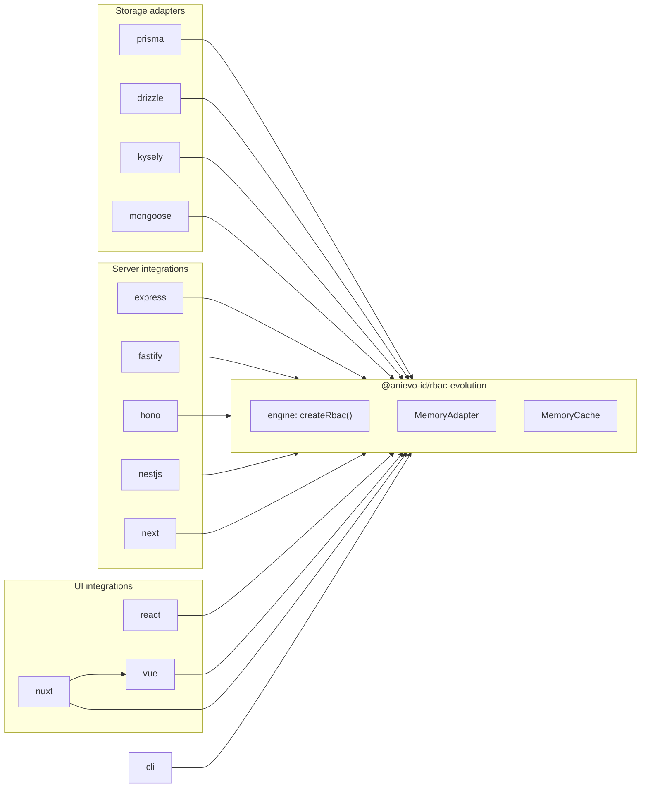
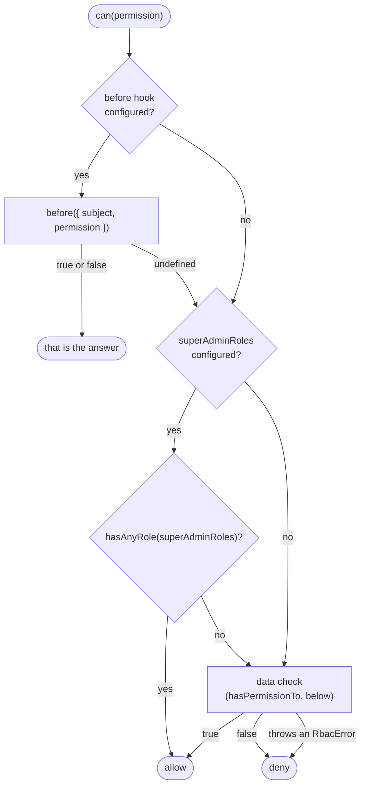
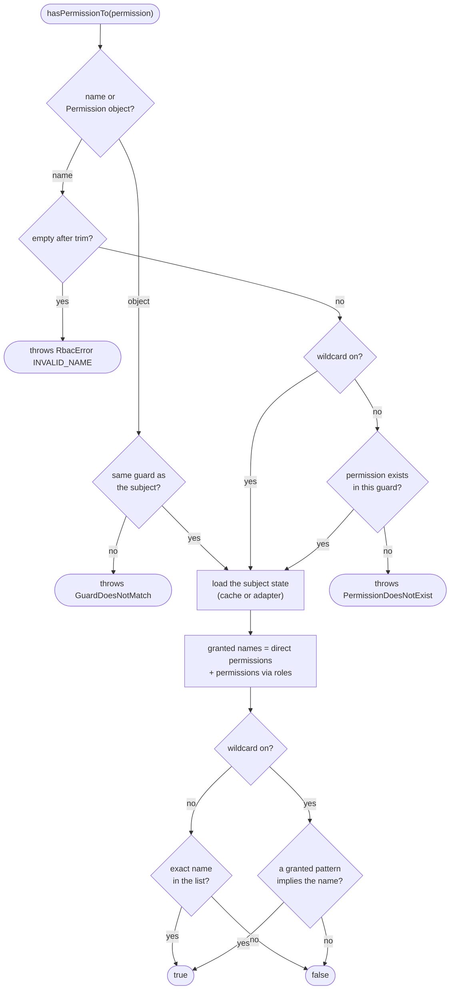
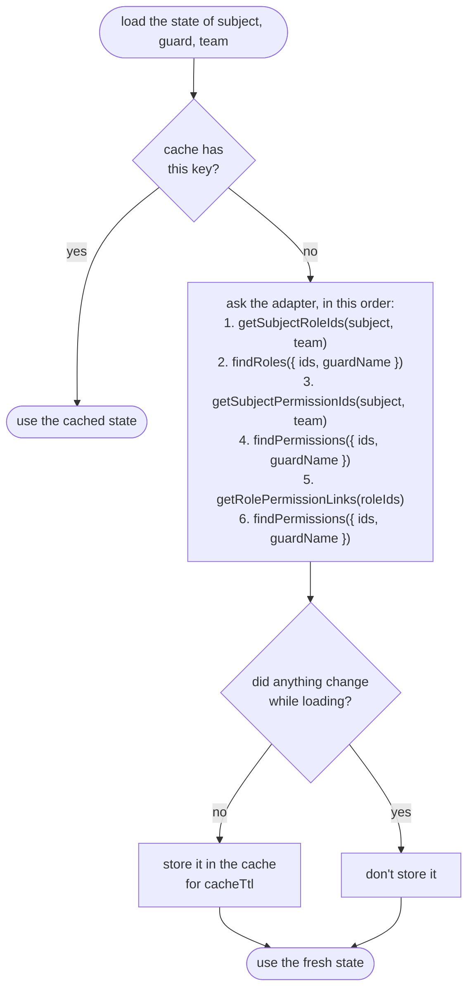
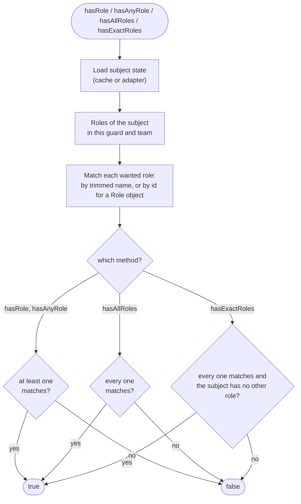
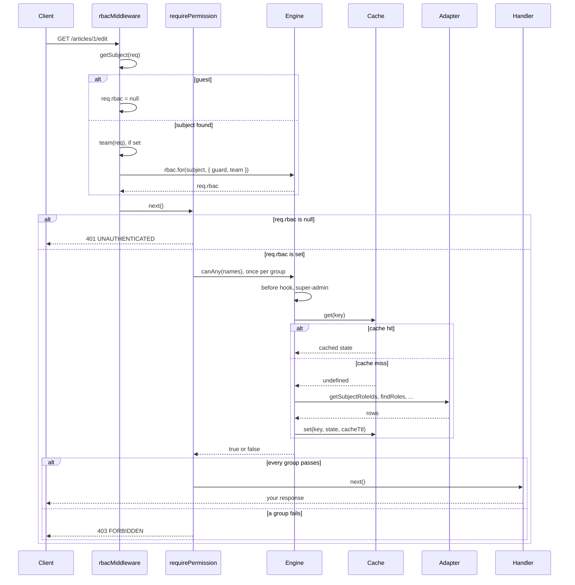
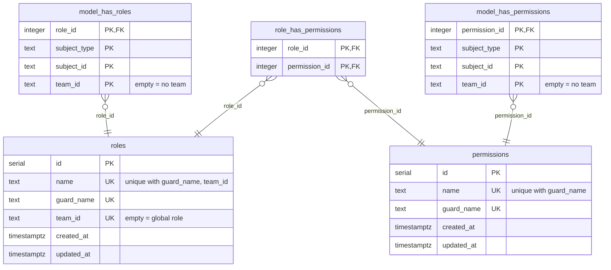
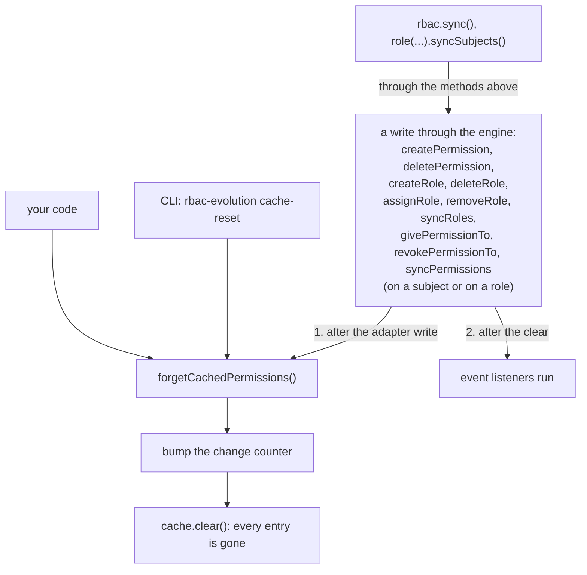

# How it works

This page looks under the hood. It shows how the packages fit together, how a check is decided, what a guarded request does, which tables the SQL adapters use, and when the cache is cleared.

You don't need any of this to use the library. It helps when you debug a check that doesn't do what you expect, write a [custom adapter](/adapters/custom), or plan a production setup.

## Packages and how they fit together

Everything is built around one engine, the core package. It has no runtime dependencies and includes the in-memory adapter.

- An **adapter** decides where roles and permissions are stored. The engine only talks to the `RbacAdapter` interface.
- An **integration** connects the engine to a framework. It finds the current user and calls the engine.
- The **CLI** loads your engine from a config file and runs commands against it.

Each arrow means "depends on". In the diagram, `express` is short for `@anievo-id/rbac-evolution-express`, and so on. Every package depends on the core, and the Nuxt module also builds on the Vue package.



Most packages also have a peer dependency on the library they plug into, so you bring your own version:

| Package | Peer dependencies | Other dependencies |
| --- | --- | --- |
| `-prisma` | `@prisma/client` 5.12+ or 6 | |
| `-drizzle` | `drizzle-orm` 0.38+ | |
| `-kysely` | `kysely` 0.28 or 0.29 | |
| `-mongoose` | `mongoose` 8 | |
| `-express` | `express` 4+ | |
| `-fastify` | `fastify` 5+ | `fastify-plugin` |
| `-hono` | `hono` 4+ | |
| `-nestjs` | `@nestjs/common`, `@nestjs/core` 10 to 12, `reflect-metadata` | |
| `-next` | `next` 14+, `react` 18+ | |
| `-react` | `react` 18+ | |
| `-vue` | `vue` 3.3+ | |
| `-nuxt` | `nuxt` 3 or 4, `vue` 3.3+ | `-vue`, `@nuxt/kit` |
| `-cli` | | `jiti` (loads `rbac.config.ts` without a build step) |

The Nuxt module is listed with the UI packages, but it also has server helpers for Nitro routes. The Next.js package does not use the React package. They work well together, but you install them separately.

## How a permission check is decided

Every check starts with `rbac.for()`. It fixes the **guard** and the **team** for all calls on the returned object:

```ts
const subject = rbac.for(user, { guard: 'api', team: 42 })

await subject.can('edit articles')             // checked in guard `api`, team 42
await subject.hasPermissionTo('edit articles') // same scope
```

Without a guard, the engine uses `defaultGuard` (`web` by default). Without a team, it uses `null`, which means "no team". Passing a team when the engine was created without `teams: true` throws an `RbacError` with code `TEAMS_NOT_ENABLED`, right in `rbac.for()`.

`can()` is the authorization check. It runs the `before` hook and the super-admin check first. If neither decides, it runs the data check and turns its errors into `false`:



`hasPermissionTo()` is the data check. It only looks at what is stored, and it throws for a bad name, an unknown permission or a permission object of another guard:



Some details:

- **The `before` hook** gets the trimmed name (or the object's `name`). It can allow or deny anything, even for super-admins. It runs on every `can()`, `cannot()`, `canAny()` and `canAll()` call, once per permission.
- **Super-admin** is a role check on the same subject state. With teams, the super-admin role must be assigned in the current team.
- **"Permission exists"** looks at all permission names of the guard. With caching on, that list is cached too, so this step doesn't query the database on every check.
- **Wildcards** skip the existence check, because a name like `articles.edit` may only be covered by `articles.*`. A granted pattern that can't be parsed simply doesn't match. See [Wildcard permissions](/basic-usage/wildcard-permissions).
- **Errors that are not an `RbacError`**, like a database that is down, are never turned into `false`. `can()` lets them through, and a route guard passes them on to your error handler.

`canAny()` and `canAll()` call `can()` once per name and stop at the first answer that decides. `hasAnyPermission()` and `hasAllPermissions()` do the same with the data check, but return `false` instead of throwing.

### Loading the subject state

The **subject state** is everything the engine knows about one subject in one guard and team: its roles, its direct permissions, and the permissions of its roles. It is loaded once and then cached.



The cache key is `rbac:` followed by `[guard, team, subject type, subject id]` as JSON. Step 4 gives the direct permissions, and step 6 the permissions via roles.

With `cache: false`, every call loads the state from the adapter and nothing is stored.

Two things follow from this:

- **Guards** filter the rows: roles and permissions of another guard are ignored, even if they are linked.
- **Teams** filter the links: only assignments made in exactly this team count. An assignment made without a team does not show up inside team 42. See [Teams](/basic-usage/teams).

Steps with nothing to look up are skipped. A subject without roles never runs `findRoles()` or `getRolePermissionLinks()`.

### Role checks

Role checks read the same subject state. They are simpler than permission checks:



- `hasRole()` is the same as `hasAnyRole()`. Pass an array to check several roles.
- Role checks never run the `before` hook or the super-admin check.
- An unknown role name doesn't throw. It just doesn't match.

## A request through a framework integration

This is what happens when a request hits an Express route guarded with `requirePermission('edit articles')`. `rbacMiddleware()` runs first and puts the scoped subject on `req.rbac`. The guard then asks the engine.



The default responses are JSON:

| Status | When | Body |
| --- | --- | --- |
| `401` | `req.rbac` is `null` (a guest) | `{ "error": "UNAUTHENTICATED", "message": "User is not logged in." }` |
| `403` | A group of names fails | `{ "error": "FORBIDDEN", "reason": "permission", "message": "User does not have the right permissions." }` |

If `rbacMiddleware()` did not run, `req.rbac` is `undefined` and the guard throws `RbacMiddlewareMissingError`. Like any other error, it goes to your error handler.

Some details:

- Names are grouped. `requirePermission('a', 'b')` makes two groups, and both must pass. `requirePermission('a|b')` makes one group, and any name in it passes. `{ any: true }` puts all names in one group.
- `requireRole()` uses `hasAnyRole()` instead of `canAny()`. `requireRoleOrPermission()` tries the roles first, then the permissions.
- The 403 `reason` is the kind of guard: `permission`, `role` or `role_or_permission`. The `message` changes with it. With `exposeRequirements: true` the body also has a `required` field with the groups of names.
- `onUnauthenticated` and `onForbidden` replace the default 401 and 403 responses. With the `guard` option, the check runs in that guard instead (`req.rbac.withScope({ guard })`).
- With wildcards off, the engine also reads the cached list of the guard's permission names, the same way.
- Every guard is wrapped in `asyncHandler()`, so an error (for example from the database) goes to `next(err)` on Express 4 and 5.

The other integrations follow the same shape: resolve the subject once per request, scope it with `rbac.for()`, then check it in a guard. Fastify, Hono, NestJS and the Nuxt server helpers use the same `satisfiesRequirement()` from the core, so the checks are identical. Fastify, Hono, NestJS and Next.js send the same 401 and 403 JSON bodies. Nuxt's server helpers throw an error with status 401 or 403 and put the same fields in its `data`. See [Frameworks](/frameworks/express).

## Data model

The SQL adapters (Prisma, Drizzle and Kysely) use the same five tables, with the same table and column names. This diagram uses the PostgreSQL types. The Mongoose adapter stores the same data in five collections with camelCase field names.



All foreign keys use `ON DELETE CASCADE`, so deleting a role or a permission also deletes its links. Each adapter can add a prefix to every table name, for example `rbac_permissions`.

For [temporary access](/basic-usage/temporary-access) (1.2), `model_has_roles` and `model_has_permissions` can have one more, nullable column, `expires_at`. It is optional: an adapter only reads and writes it when created with `{ expiry: true }`, and `NULL` means the link never ends.

### Compared with spatie

The table names are the same as in spatie/laravel-permission: `permissions`, `roles`, `role_has_permissions`, `model_has_roles` and `model_has_permissions`. The differences:

| | spatie/laravel-permission | RBAC Evolution |
| --- | --- | --- |
| Who holds a role | `model_type` + `model_id` | `subject_type` + `subject_id`. The id is text, so numbers, UUIDs and other ids all fit. |
| Team column | Only with teams on. Nullable on `roles`, part of the key on the pivot tables. | Always there, on `roles`, `model_has_roles` and `model_has_permissions`. It is `NOT NULL`, and `''` means "no team". |
| Team column type | An integer by default (configurable) | Always text |
| Unique role name | Per guard (and team, with teams on) | Per guard and team: `(name, guard_name, team_id)` |

Because `team_id` is always there, you can turn on `teams: true` later without a migration. The engine uses `null` for "no team". The SQL and Mongoose adapters store it as `''`.

## Cache and invalidation

The engine caches two kinds of entries in its `CacheStore` (a `MemoryCache` by default):

| Key | Value | Used by |
| --- | --- | --- |
| `rbac:["<guard>",<team>,"<type>","<id>"]` | The subject state: roles, direct permissions, permissions via roles | Every read on `rbac.for(subject)`: `can()`, `hasRole()`, `getAllPermissions()`, `snapshot()`, ... |
| `rbac:permissions:["<guard>"]` | All permission names of the guard | The "permission exists" step of `can()` and `hasPermissionTo()` when wildcards are off |

Entries live for `cacheTtl` (24 hours by default), or less when a subject state holds a [temporary](/basic-usage/temporary-access) role or permission: then the entry ends at the earliest `expiresAt` in it, and the state carries that moment so a later hit past it is recomputed. The cache is not split by subject when it is cleared: every change clears **all** entries.



The change counter protects against a race. A lookup that started before a change finishes after the clear, and it would put old data back into the cache. The engine sees that the counter moved and doesn't store that result.

What is **not** cleared for you:

- Changes made without this `rbac` instance: raw SQL, migrations, an admin tool, another service, or a second `createRbac()` instance.
- The cache of other processes, unless they share one store (for example Redis). The change counter only exists in one process.

In those cases, call `rbac.forgetCachedPermissions()` yourself, use a shared store, or lower `cacheTtl`. See [Cache](/advanced/cache) for the options.

Reads that don't go through the subject state are not cached at all: `findRole()`, `getRoles()`, `getPermissions()`, `rbac.role(...).getPermissions()`, and `subjectsWithRole()` / `subjectsWithPermission()`.

## Related pages

- [Basic usage](/basic-usage/basic-usage): subjects, roles and permissions
- [Permissions via roles](/basic-usage/roles) and [Direct permissions](/basic-usage/direct-permissions)
- [Multiple guards](/basic-usage/multiple-guards) and [Teams](/basic-usage/teams)
- [Wildcard permissions](/basic-usage/wildcard-permissions)
- [Super-admin](/basic-usage/super-admin): `superAdminRoles` and the `before` hook
- [Cache](/advanced/cache) and [Events](/advanced/events)
- Frameworks: [Express](/frameworks/express), [Fastify](/frameworks/fastify), [Hono](/frameworks/hono), [NestJS](/frameworks/nestjs), [Next.js](/frameworks/nextjs), [Nuxt](/frameworks/nuxt), [React](/frameworks/react), [Vue](/frameworks/vue)
- Adapters: [Overview](/adapters/overview), [Prisma](/adapters/prisma), [Drizzle](/adapters/drizzle), [Kysely](/adapters/kysely), [Mongoose](/adapters/mongoose), [Memory](/adapters/memory), [Custom adapter](/adapters/custom)
