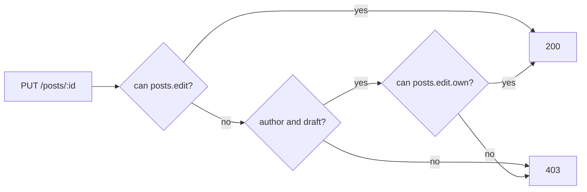

# Blog / CMS

A publication with many authors, built on [Express](/frameworks/express) with a [Vue](/frameworks/vue) front end.
This page shows the whole setup: roles, seed, assignments, route guards, edge cases and tests.

## The app

Writers draft posts, editors review and publish them, and moderators keep the comments clean. Admins run the site.
The tricky part is ownership: a writer may edit **their own** draft, an editor may edit **any** post.

| User | What they do |
| --- | --- |
| Writer | Writes posts. Edits and deletes their own drafts. |
| Editor | Edits and publishes any post. Moderates comments. |
| Moderator | Moderates comments and bans spammers. Doesn't touch posts. |
| Admin | Everything, including user management and site settings. |

## Roles and permissions

| Permission | writer | editor | moderator | admin |
| --- | :---: | :---: | :---: | :---: |
| `posts.create` | ✔ | ✔ | | ✔ |
| `posts.edit.own` | ✔ | | | ✔ |
| `posts.edit` | | ✔ | | ✔ |
| `posts.publish` | | ✔ | | ✔ |
| `posts.delete.own` | ✔ | ✔ | | ✔ |
| `posts.delete` | | | | ✔ |
| `comments.moderate` | | ✔ | ✔ | ✔ |
| `users.ban` | | | ✔ | ✔ |
| `users.manage` | | | | ✔ |
| `settings.manage` | | | | ✔ |

Why this split:

- **Two permissions for one action.** `posts.edit.own` and `posts.edit` both mean "edit a post". The permission
  says *which* posts. The engine doesn't know who wrote a post, so your code checks the author (see
  [Guard the routes](#guard-the-routes)).
- **The code checks permissions, never roles.** If you later let senior writers publish, you change the seed, not
  the routes. See [Roles vs permissions](/best-practices/roles-vs-permissions).
- **Roles overlap.** Editors and moderators both moderate comments. A user can have both roles.
- **`admin` gets `'*'`.** The seed gives it every permission that exists. Its snapshot then lists everything, so
  the UI needs no special case. (The [internal tools](/use-cases/internal-tools) page shows the other way, a
  super-admin role.)

## Seed it

Define the names once, with [typed names](/basic-usage/typed-names). A typo in a route guard or a seed is then a
compile error.

```ts
// src/rbac.ts
import { createRbac } from '@anievo-id/rbac-evolution'
import { createGuards } from '@anievo-id/rbac-evolution-express'
import { adapter } from './db' // e.g. new PrismaAdapter(prisma), see Adapters

export type BlogRbac = {
  permissions:
    | 'posts.create'
    | 'posts.edit.own'
    | 'posts.edit'
    | 'posts.publish'
    | 'posts.delete.own'
    | 'posts.delete'
    | 'comments.moderate'
    | 'users.ban'
    | 'users.manage'
    | 'settings.manage'
  roles: 'writer' | 'editor' | 'moderator' | 'admin'
}

export const rbac = createRbac<BlogRbac>({ adapter })

export const { requirePermission, requireRole } = createGuards<BlogRbac>()
```

The seed is the table above, as data:

```ts
// src/seed.ts
import type { SyncDefinition } from '@anievo-id/rbac-evolution'
import type { BlogRbac } from './rbac'

export const blogSeed = {
  permissions: ['posts.delete', 'users.manage', 'settings.manage'], // only admin has these
  roles: {
    writer: ['posts.create', 'posts.edit.own', 'posts.delete.own'],
    editor: ['posts.create', 'posts.edit', 'posts.publish', 'posts.delete.own', 'comments.moderate'],
    moderator: ['comments.moderate', 'users.ban'],
    admin: '*',
  },
} satisfies SyncDefinition<BlogRbac>
```

Permissions used by a role are created automatically, so `permissions` only lists the ones no other role uses.
Run the sync on every deploy. It is idempotent:

```ts
// scripts/seed.ts
import { rbac } from '../src/rbac'
import { blogSeed } from '../src/seed'

const plan = await rbac.sync(blogSeed, { dryRun: true })
console.log('roles to update:', plan.updated.roles.map((r) => r.name))

await rbac.sync(blogSeed)
```

See [Seeding](/advanced/seeding) for `prune` and the CLI.

## Assign roles

New authors join through an invite from an admin. The invite carries the role:

```ts
// src/invites.ts
import { db } from './db'
import { rbac, type BlogRbac } from './rbac'
import type { RoleName } from '@anievo-id/rbac-evolution'

export async function acceptInvite(email: string, role: RoleName<BlogRbac>) {
  const user = (await db.users.findByEmail(email)) ?? (await db.users.create({ email }))
  await rbac.for({ type: 'user', id: user.id }).assignRole(role)
  return user
}
```

Promotion is an admin screen. `syncRoles()` replaces the user's roles with exactly the list you send, so the same
endpoint promotes, demotes and adds a second role:

```ts
// src/admin.ts
import express from 'express'
import type { RoleName } from '@anievo-id/rbac-evolution'
import { asyncHandler } from '@anievo-id/rbac-evolution-express'
import { rbac, requirePermission, type BlogRbac } from './rbac'

const ROLES: readonly RoleName<BlogRbac>[] = ['writer', 'editor', 'moderator', 'admin']
const isRole = (name: unknown): name is RoleName<BlogRbac> => ROLES.includes(name as RoleName<BlogRbac>)

export const admin = express.Router()
admin.use(requirePermission('users.manage'))

// PUT /admin/users/42/roles  { "roles": ["editor", "moderator"] }
admin.put(
  '/users/:id/roles',
  asyncHandler(async (req, res) => {
    const roles: unknown[] = Array.isArray(req.body.roles) ? req.body.roles : []
    if (!roles.every(isRole)) {
      res.status(422).json({ error: 'Unknown role' })
      return
    }
    await rbac.for({ type: 'user', id: Number(req.params.id) }).syncRoles(roles)
    res.json({ roles })
  }),
)
```

The request body is user input. Check it against the list of roles you know before you pass it on.

## Guard the routes

Put the ownership rule in one function, so the API and the UI flags agree:

```ts
// src/policies.ts
import type { SubjectRbac } from '@anievo-id/rbac-evolution'
import type { Post } from './db'

/** Editors edit any post. Writers edit their own drafts. */
export async function canEditPost(access: SubjectRbac, post: Post): Promise<boolean> {
  if (await access.can('posts.edit')) return true
  const isAuthor = post.authorId === access.subject.id
  return isAuthor && post.status === 'draft' && (await access.can('posts.edit.own'))
}

/** Admins delete any post. Authors delete their own drafts. */
export async function canDeletePost(access: SubjectRbac, post: Post): Promise<boolean> {
  if (await access.can('posts.delete')) return true
  const isAuthor = post.authorId === access.subject.id
  return isAuthor && post.status === 'draft' && (await access.can('posts.delete.own'))
}
```



The route guard is a fast first filter: it lets through anyone who could edit *some* post. The handler then loads
the post and asks the policy:

```ts
// src/posts.ts
import express from 'express'
import { asyncHandler } from '@anievo-id/rbac-evolution-express'
import { db } from './db'
import { canDeletePost, canEditPost } from './policies'
import { requirePermission } from './rbac'

export const posts = express.Router()

posts.post(
  '/',
  requirePermission('posts.create'),
  asyncHandler(async (req, res) => {
    const post = await db.posts.create({ authorId: req.user!.id, title: req.body.title })
    res.status(201).json(post)
  }),
)

posts.put(
  '/:id',
  requirePermission('posts.edit|posts.edit.own'), // any of them
  asyncHandler(async (req, res) => {
    const post = await db.posts.find(Number(req.params.id))
    if (!post) {
      res.sendStatus(404)
      return
    }
    if (!(await canEditPost(req.rbac!, post))) {
      res.sendStatus(403)
      return
    }
    res.json(await db.posts.update(post.id, { title: req.body.title }))
  }),
)

posts.post(
  '/:id/publish',
  requirePermission('posts.publish'),
  asyncHandler(async (req, res) => {
    res.json(await db.posts.update(Number(req.params.id), { status: 'published' }))
  }),
)

posts.delete(
  '/:id',
  requirePermission('posts.delete|posts.delete.own'),
  asyncHandler(async (req, res) => {
    const post = await db.posts.find(Number(req.params.id))
    if (!post) {
      res.sendStatus(404)
      return
    }
    if (!(await canDeletePost(req.rbac!, post))) {
      res.sendStatus(403)
      return
    }
    await db.posts.delete(post.id)
    res.sendStatus(204)
  }),
)
```

Wire it up. `rbacMiddleware` sets `req.rbac` for every request, so the guards and the policies can use it:

```ts
// src/app.ts
import express from 'express'
import { asyncHandler, rbacMiddleware } from '@anievo-id/rbac-evolution-express'
import { admin } from './admin'
import { db } from './db'
import { canDeletePost, canEditPost } from './policies'
import { posts } from './posts'
import { rbac } from './rbac'

export const app = express()
app.use(express.json())
// app.use(yourAuthMiddleware) sets req.user
app.use(
  rbacMiddleware({
    rbac,
    getSubject: (req) => (req.user ? { type: 'user', id: req.user.id } : null),
  }),
)

// The snapshot for the Vue plugin
app.get('/api/me/permissions', async (req, res) => {
  res.json(req.rbac ? await req.rbac.snapshot() : null)
})

// A post, with what the current user may do with it
app.get(
  '/api/posts/:id',
  asyncHandler(async (req, res) => {
    const post = await db.posts.find(Number(req.params.id))
    if (!post) {
      res.sendStatus(404)
      return
    }
    const access = req.rbac
    res.json({
      ...post,
      can: {
        edit: access ? await canEditPost(access, post) : false,
        delete: access ? await canDeletePost(access, post) : false,
      },
    })
  }),
)

app.use('/api/posts', posts)
app.use('/api/admin', admin)
```

### The Vue side

The [Vue plugin](/frameworks/vue) reads the snapshot from `/api/me/permissions`. Use `v-can` for abilities that
don't depend on a post. Use the `can` flags from the API for the ownership rules, because the snapshot doesn't know
who wrote a post:

```vue
<script setup lang="ts">
defineProps<{ post: { id: number; title: string; can: { edit: boolean; delete: boolean } } }>()
</script>

<template>
  <article>
    <h1>{{ post.title }}</h1>

    <a v-if="post.can.edit" :href="`/posts/${post.id}/edit`">Edit</a>
    <button v-if="post.can.delete">Delete</button>
    <button v-can="'posts.publish'">Publish</button>

    <RouterLink v-can="'comments.moderate'" to="/moderation">Moderation queue</RouterLink>
    <RouterLink v-can="'users.manage'" to="/admin/users">Users</RouterLink>
  </article>
</template>
```

::: tip The UI only hides
`v-can` hides a button. The Express guards and policies above are what actually stop the request.
:::

## Edge cases

### Published posts are locked for writers

The policy only lets an author edit a **draft**. Once an editor publishes the post, only `posts.edit` can change
it. This rule lives in your code, next to the permission check, because it depends on the post's state.

### Banning a user

A moderator bans a spammer. Don't remove their roles: if the ban is lifted, you would have to remember which roles
they had. Store the ban on the user and deny everything in a `before` hook on the engine in `src/rbac.ts`:

```ts
export const rbac = createRbac<BlogRbac>({
  adapter,
  before: async ({ subject }) => {
    const user = await db.users.find(Number(subject.subject.id))
    return user?.bannedAt ? false : undefined // false denies, undefined continues
  },
})
```

The hook runs on every `can()` check, so keep the lookup cheap (a cached user, or a flag in the session).
`hasPermissionTo()` and `snapshot()` skip the hook, so send `null` as the snapshot for a banned user. See
[Super-admin](/basic-usage/super-admin#the-before-hook).

The ban route itself is an ordinary guarded route:

```ts
app.post('/api/users/:id/ban', requirePermission('users.ban'), async (req, res) => {
  await db.users.update(Number(req.params.id), { bannedAt: new Date() })
  res.sendStatus(204)
})
```

### Keeping at least one admin

An admin who removes their own `admin` role can lock everyone out. Check it in the roles endpoint, before the
`syncRoles()` call:

```ts
// in src/admin.ts
async function removesLastAdmin(userId: number, newRoles: readonly string[]): Promise<boolean> {
  if (newRoles.includes('admin')) return false
  const admins = await rbac.subjectsWithRole('user', 'admin')
  return admins.length === 1 && String(admins[0]) === String(userId)
}

// in PUT /users/:id/roles:
// if (await removesLastAdmin(Number(req.params.id), roles)) return res.status(409).json(...)
```

### Authors who leave

When a writer leaves, remove their roles (and any direct permission) with `revokeAll()`. Their posts stay, and editors can still edit them,
because `posts.edit` doesn't depend on the author.

::: tip Wildcards
With [`wildcard: true`](/basic-usage/wildcard-permissions), a shorter permission covers the longer ones:
`posts.edit` would also cover `posts.edit.own`. This page keeps wildcards off, so the two are separate names and
the table above lists both.
:::

## Test it

Test the policy against the real seed with the [in-memory adapter](/advanced/testing). No database or HTTP server
is needed:

```ts
// test/policies.test.ts
import { beforeEach, describe, expect, it } from 'vitest'
import { createRbac, MemoryAdapter, type Rbac } from '@anievo-id/rbac-evolution'
import type { Post } from '../src/db'
import { canEditPost } from '../src/policies'
import type { BlogRbac } from '../src/rbac'
import { blogSeed } from '../src/seed'

describe('editing posts', () => {
  let rbac: Rbac<BlogRbac>
  const alice = { type: 'user', id: 1 } // writer
  const bob = { type: 'user', id: 2 } // writer
  const erin = { type: 'user', id: 3 } // editor
  const draft: Post = { id: 10, authorId: 1, title: 'Hello', status: 'draft' }

  beforeEach(async () => {
    rbac = createRbac<BlogRbac>({ adapter: new MemoryAdapter(), cache: false })
    await rbac.sync(blogSeed)
    await rbac.for(alice).assignRole('writer')
    await rbac.for(bob).assignRole('writer')
    await rbac.for(erin).assignRole('editor')
  })

  it('lets writers edit their own drafts only', async () => {
    expect(await canEditPost(rbac.for(alice), draft)).toBe(true)
    expect(await canEditPost(rbac.for(bob), draft)).toBe(false)
    expect(await canEditPost(rbac.for(alice), { ...draft, status: 'published' })).toBe(false)
  })

  it('lets editors edit any post', async () => {
    expect(await canEditPost(rbac.for(erin), { ...draft, status: 'published' })).toBe(true)
  })

  it('gives admins every permission', async () => {
    await rbac.for(bob).syncRoles('admin')
    expect(await rbac.for(bob).canAll('posts.delete', 'settings.manage')).toBe(true)
  })
})
```

## Related

- [Roles vs permissions](/best-practices/roles-vs-permissions)
- [Express](/frameworks/express) and [Vue](/frameworks/vue)
- [Seeding](/advanced/seeding) and [Typed names](/basic-usage/typed-names)
- [Super-admin and the `before` hook](/basic-usage/super-admin)
- [Testing](/advanced/testing)
