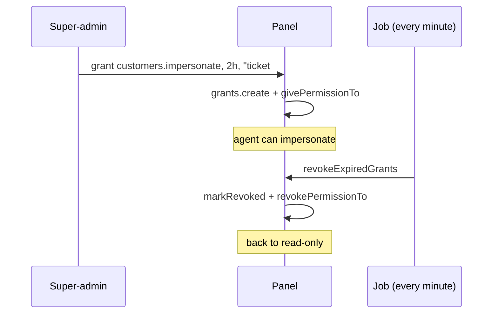

# Internal admin panel

The company's own back office: look up customers, fix accounts, retry failed jobs. Built with
[Fastify](/frameworks/fastify) and a [React](/frameworks/react) front end. It has a
[super-admin](/basic-usage/super-admin) role, read-only support agents, and temporary access that ends on its own.

## The app

Only employees sign in. Most of them only need to **look**: a support agent reads a customer's account to answer a
ticket. A few may **change** things. Some actions, like logging in as a customer, are given for a few hours when a
ticket needs it, then taken away again.

| User | What they do |
| --- | --- |
| Support agent | Reads customers, orders and the audit log of a customer. Changes nothing. |
| Support lead | Everything an agent does, plus editing accounts and refunds. |
| Engineer | Reads customers, retries failed jobs, toggles feature flags. |
| Super-admin | Two or three people. Can do everything, including granting temporary access. |

## Roles and permissions

| Permission | support-agent | support-lead | engineer | super-admin |
| --- | :---: | :---: | :---: | :---: |
| `panel.access` | ✔ | ✔ | ✔ | all |
| `customers.view` | ✔ | ✔ | ✔ | all |
| `customers.edit` | | ✔ | | all |
| `customers.impersonate` | temporary | temporary | | all |
| `orders.view` | ✔ | ✔ | | all |
| `orders.refund` | | ✔ | | all |
| `jobs.view` | | | ✔ | all |
| `jobs.retry` | | | ✔ | all |
| `flags.manage` | | | ✔ | all |
| `audit-log.view` | | ✔ | ✔ | all |
| `access.grant` | | | | all |
| `audit-log.delete` | | | | **nobody** |

Why this split:

- **Read-only is the default.** `support-agent` has `panel.access` and `*.view` permissions, nothing else. Every write is a separate
  permission, so a new agent can't break anything on day one.
- **`super-admin` holds no permissions.** It is listed in `superAdminRoles`, so it passes every `can()` check,
  including permissions you add next month. Compare the [blog](/use-cases/blog-cms), where `admin: '*'` stores every
  permission instead.
- **Some things nobody may do.** A `before` hook denies `audit-log.delete` to everyone, super-admins too.
- **Temporary access is a direct permission.** "Impersonate customers until 6 pm" belongs to one person for a few
  hours. A role would be the wrong tool. See [Direct permissions](/basic-usage/direct-permissions).

## Seed it

```ts
// src/rbac.ts
import { createRbac } from '@anievo-id/rbac-evolution'
import { createGuards } from '@anievo-id/rbac-evolution-fastify'
import { adapter } from './db' // e.g. new DrizzleAdapter(db), see Adapters

export type ToolsRbac = {
  permissions:
    | 'panel.access'
    | 'customers.view'
    | 'customers.edit'
    | 'customers.impersonate'
    | 'orders.view'
    | 'orders.refund'
    | 'jobs.view'
    | 'jobs.retry'
    | 'flags.manage'
    | 'audit-log.view'
    | 'audit-log.delete'
    | 'access.grant'
  roles: 'support-agent' | 'support-lead' | 'engineer' | 'super-admin'
}

/** Shared with the React app, so the UI agrees with the server. */
export const SUPER_ADMIN_ROLES = ['super-admin'] as const

export const rbac = createRbac<ToolsRbac>({
  adapter,
  superAdminRoles: SUPER_ADMIN_ROLES,
  // Runs before the super-admin check: false here denies even super-admins.
  before: ({ permission }) => (permission === 'audit-log.delete' ? false : undefined),
})

export const { requirePermission } = createGuards<ToolsRbac>()
```

```ts
// src/seed.ts
import type { SyncDefinition } from '@anievo-id/rbac-evolution'
import type { ToolsRbac } from './rbac'

export const toolsSeed = {
  permissions: ['customers.impersonate', 'audit-log.delete', 'access.grant'], // only granted, never in a role
  roles: {
    'support-agent': ['panel.access', 'customers.view', 'orders.view'],
    'support-lead': ['panel.access', 'customers.view', 'orders.view', 'customers.edit', 'orders.refund', 'audit-log.view'],
    engineer: ['panel.access', 'customers.view', 'jobs.view', 'jobs.retry', 'flags.manage', 'audit-log.view'],
    'super-admin': [],
  },
} satisfies SyncDefinition<ToolsRbac>
```

`'super-admin': []` creates the role with no permissions. Run `await rbac.sync(toolsSeed)` on deploy.

## Assign roles

Employees come from your identity provider. Map their group to a role when they sign in, so HR offboarding in the
identity provider also ends their access here:

```ts
// src/sso.ts
import type { RoleName } from '@anievo-id/rbac-evolution'
import { rbac, type ToolsRbac } from './rbac'

const ROLE_BY_GROUP: Record<string, RoleName<ToolsRbac>> = {
  'support-tier-1': 'support-agent',
  'support-tier-2': 'support-lead',
  engineering: 'engineer',
}

/** Called after every SSO login, with the groups from the identity provider. */
export async function syncStaffRoles(staffId: number, groups: string[]) {
  const roles = groups.flatMap((group) => (ROLE_BY_GROUP[group] ? [ROLE_BY_GROUP[group]] : []))
  const staff = rbac.for({ type: 'staff', id: staffId })

  // super-admin is never given by a group: keep it if they have it
  if (await staff.hasRole('super-admin')) roles.push('super-admin')
  await staff.syncRoles(roles)
}
```

Super-admins are rare and named. Give the role by hand, with the [CLI](/basic-usage/cli), and review the list
regularly:

```ts
const superAdmins = await rbac.subjectsWithRole('staff', 'super-admin') // ids, for the quarterly review
```

### Temporary access

A support agent needs to log in as a customer to reproduce a bug. A super-admin grants
`customers.impersonate` for two hours, with a reason. The engine stores the permission. Your own table stores
**when it ends**, because the engine has no expiry:

```ts
// src/access-grants.ts
import type { PermissionName, Rbac } from '@anievo-id/rbac-evolution'
import type { ToolsRbac } from './rbac'

/** What can be granted for a while. Keep the list short. */
export type TemporaryPermission = Extract<PermissionName<ToolsRbac>, 'customers.impersonate' | 'orders.refund'>

export interface AccessGrant {
  id: number
  staffId: number
  permission: TemporaryPermission
  reason: string
  grantedBy: number
  expiresAt: Date
  revokedAt: Date | null
}

/** Your table of grants (any database). */
export interface GrantStore {
  create(grant: Omit<AccessGrant, 'id' | 'revokedAt'>): Promise<AccessGrant>
  /** Grants with `expiresAt <= now` that are not revoked yet. */
  findExpired(now: Date): Promise<AccessGrant[]>
  /** Whether the staff member has another grant of this permission that is still running. */
  hasActive(staffId: number, permission: TemporaryPermission, now: Date): Promise<boolean>
  markRevoked(id: number, at: Date): Promise<void>
}

export async function grantTemporaryAccess(
  rbac: Rbac<ToolsRbac>,
  grants: GrantStore,
  input: { staffId: number; permission: TemporaryPermission; hours: number; reason: string; grantedBy: number },
  now = new Date(),
): Promise<AccessGrant> {
  const { hours, ...rest } = input
  const grant = await grants.create({ ...rest, expiresAt: new Date(now.getTime() + hours * 3_600_000) })
  await rbac.for({ type: 'staff', id: input.staffId }).givePermissionTo(input.permission)
  return grant
}

/** Run every minute. Takes back what has expired. */
export async function revokeExpiredGrants(rbac: Rbac<ToolsRbac>, grants: GrantStore, now = new Date()) {
  for (const grant of await grants.findExpired(now)) {
    await grants.markRevoked(grant.id, now)
    // a second, longer grant of the same permission keeps it
    if (await grants.hasActive(grant.staffId, grant.permission, now)) continue
    await rbac.for({ type: 'staff', id: grant.staffId }).revokePermissionTo(grant.permission)
  }
}
```



`revokePermissionTo()` removes the **direct** permission only. If the person also has it through a role, they keep
it, which is what you want.

## Guard the routes

```ts
// src/app.ts
import Fastify from 'fastify'
import { rbacPlugin } from '@anievo-id/rbac-evolution-fastify'
import { grantTemporaryAccess, revokeExpiredGrants, type TemporaryPermission } from './access-grants'
import { grants } from './db'
import { rbac, requirePermission } from './rbac'

export const app = Fastify()

// await app.register(yourSsoPlugin) sets request.staff
await app.register(rbacPlugin, {
  rbac,
  getSubject: (request) => (request.staff ? { type: 'staff', id: request.staff.id } : null),
})

await app.register(
  async (admin) => {
    admin.addHook('preHandler', requirePermission('panel.access')) // every route below

    admin.get('/customers/:id', { preHandler: requirePermission('customers.view') }, async (request) => {
      return { id: (request.params as { id: string }).id }
    })

    admin.patch('/customers/:id', { preHandler: requirePermission('customers.edit') }, async () => ({ ok: true }))

    admin.post('/customers/:id/impersonate', { preHandler: requirePermission('customers.impersonate') }, async () => {
      // ...issue a short-lived session for the customer app, tagged with request.staff.id
      return { ok: true }
    })

    admin.post('/jobs/:id/retry', { preHandler: requirePermission('jobs.retry') }, async () => ({ ok: true }))

    admin.post('/access-grants', { preHandler: requirePermission('access.grant') }, async (request, reply) => {
      const body = request.body as { staffId: number; permission: TemporaryPermission; hours: number; reason: string }
      if (body.hours > 8) return reply.code(422).send({ error: 'At most 8 hours' })
      const grant = await grantTemporaryAccess(rbac, grants, { ...body, grantedBy: request.staff!.id })
      return reply.code(201).send(grant)
    })

    // The snapshot for the React app
    admin.get('/me/permissions', async (request) => (request.rbac ? request.rbac.snapshot() : null))
  },
  { prefix: '/admin' },
)

setInterval(() => void revokeExpiredGrants(rbac, grants), 60_000) // or your job scheduler
```

Validate `request.body` with a Fastify JSON schema in a real app, so `permission` can only be one of the
temporary permissions.

### The React side

A super-admin's snapshot has no permissions, because the role stores none. Pass the same `SUPER_ADMIN_ROLES` to the
provider, so the UI shows them everything:

```tsx
// web/root.tsx
import { RbacProvider } from '@anievo-id/rbac-evolution-react'
import type { RbacSnapshot } from '@anievo-id/rbac-evolution'
import { SUPER_ADMIN_ROLES } from '../src/rbac'
import { Panel } from './panel'

export function Root({ snapshot }: { snapshot: RbacSnapshot | null }) {
  return (
    <RbacProvider snapshot={snapshot} superAdminRoles={[...SUPER_ADMIN_ROLES]}>
      <Panel />
    </RbacProvider>
  )
}
```

Read-only screens show the same form to everyone and disable it when the user can't edit:

```tsx
// web/customer-form.tsx
import { Can, useCan } from '@anievo-id/rbac-evolution-react'

export function CustomerForm({ customer }: { customer: { id: string; email: string } }) {
  const canEdit = useCan('customers.edit')

  return (
    <form>
      <fieldset disabled={!canEdit}>
        <input name="email" defaultValue={customer.email} />
        {canEdit ? <button>Save</button> : <span className="badge">Read only</span>}
      </fieldset>

      <Can permission="customers.impersonate">
        <button type="button">Log in as this customer</button>
      </Can>
    </form>
  )
}
```

::: warning The `before` hook stays on the server
The React package doesn't run `before`. With `superAdminRoles`, a super-admin's UI shows "Delete audit log", and
the server answers 403. Hide such buttons with an explicit check, or leave them out of the UI.
:::

## Edge cases

### Impersonation keeps the staff member as the subject

While a support agent is logged in as a customer, the panel's subject is still `{ type: 'staff', id }`. Tag the
customer session with the staff id, and write every action to the audit log under both ids.

### Offboarding

When someone leaves, the SSO sync gives them no roles at their next login. They may never log in again, so also
remove everything when HR's webhook arrives:

```ts
await rbac.for({ type: 'staff', id: staffId }).revokeAll({ allGuards: true }) // running temporary grants too
```

`revokeAll()` removes the roles and the direct permissions in one call. `allGuards` also covers any other guard the
person had access to (an API token, a second panel).

### Who has temporary access right now?

A data check, not `can()`: it lists what is stored, without the super-admin shortcut.

```ts
const direct = await rbac.for({ type: 'staff', id: staffId }).getDirectPermissions()
// direct.map((p) => p.name) → ['customers.impersonate']
```

### Logging grants

Listen to the events to write grants and revocations to your audit log:

```ts
rbac.on('permission.attached', async (e) => {
  if (e.target === 'subject') {
    await auditLog.write({ action: 'grant', subject: e.subject, permissions: e.permissions.map((p) => p.name) })
  }
})
```

See the [Audit log recipe](/recipes/audit-log) for who made the change.

## Test it

Use a fake clock (`now`) and a small in-memory `GrantStore`:

```ts
// test/access-grants.test.ts
import { beforeEach, describe, expect, it } from 'vitest'
import { createRbac, MemoryAdapter, type Rbac } from '@anievo-id/rbac-evolution'
import { grantTemporaryAccess, revokeExpiredGrants, type AccessGrant, type GrantStore } from '../src/access-grants'
import { SUPER_ADMIN_ROLES, type ToolsRbac } from '../src/rbac'
import { toolsSeed } from '../src/seed'

function memoryGrants(): GrantStore {
  const rows: AccessGrant[] = []
  return {
    async create(grant) {
      const row = { ...grant, id: rows.length + 1, revokedAt: null }
      rows.push(row)
      return row
    },
    async findExpired(now) {
      return rows.filter((g) => !g.revokedAt && g.expiresAt <= now)
    },
    async hasActive(staffId, permission, now) {
      return rows.some((g) => g.staffId === staffId && g.permission === permission && !g.revokedAt && g.expiresAt > now)
    },
    async markRevoked(id, at) {
      rows.find((g) => g.id === id)!.revokedAt = at
    },
  }
}

describe('internal tools', () => {
  let rbac: Rbac<ToolsRbac>
  let grants: GrantStore
  const agent = { type: 'staff', id: 1 }
  const boss = { type: 'staff', id: 2 }
  const t0 = new Date('2026-01-05T09:00:00Z')
  const hours = (h: number) => new Date(t0.getTime() + h * 3_600_000)

  beforeEach(async () => {
    rbac = createRbac<ToolsRbac>({
      adapter: new MemoryAdapter(),
      cache: false,
      superAdminRoles: SUPER_ADMIN_ROLES,
      before: ({ permission }) => (permission === 'audit-log.delete' ? false : undefined),
    })
    grants = memoryGrants()
    await rbac.sync(toolsSeed)
    await rbac.for(agent).assignRole('support-agent')
    await rbac.for(boss).assignRole('super-admin')
  })

  it('keeps support agents read-only', async () => {
    expect(await rbac.for(agent).can('customers.view')).toBe(true)
    expect(await rbac.for(agent).can('customers.edit')).toBe(false)
  })

  it('lets super-admins do everything but delete the audit log', async () => {
    expect(await rbac.for(boss).can('flags.manage')).toBe(true)
    expect(await rbac.for(boss).can('audit-log.delete')).toBe(false)
  })

  it('takes temporary access back when it expires', async () => {
    const input = { staffId: 1, permission: 'customers.impersonate', reason: '#4521', grantedBy: 2 } as const
    await grantTemporaryAccess(rbac, grants, { ...input, hours: 2 }, t0)
    await grantTemporaryAccess(rbac, grants, { ...input, hours: 4 }, t0)
    expect(await rbac.for(agent).can('customers.impersonate')).toBe(true)

    await revokeExpiredGrants(rbac, grants, hours(3)) // the 2h grant ended, the 4h one still runs
    expect(await rbac.for(agent).can('customers.impersonate')).toBe(true)

    await revokeExpiredGrants(rbac, grants, hours(5))
    expect(await rbac.for(agent).can('customers.impersonate')).toBe(false)
  })
})
```

## Related

- [Super-admin and the `before` hook](/basic-usage/super-admin)
- [Direct permissions](/basic-usage/direct-permissions)
- [Fastify](/frameworks/fastify) and [React](/frameworks/react)
- [Events](/advanced/events) and the [Audit log recipe](/recipes/audit-log)
- [Security](/best-practices/security) and [Threat model](/best-practices/threat-model)
